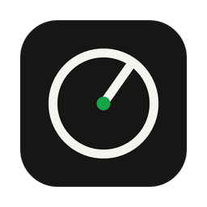
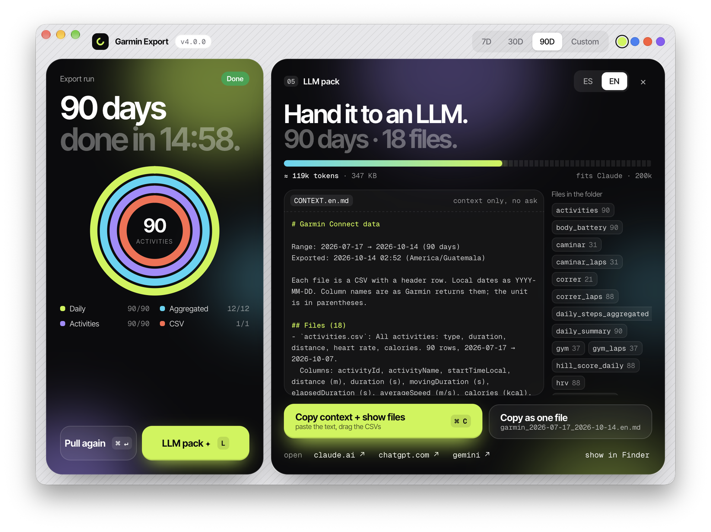
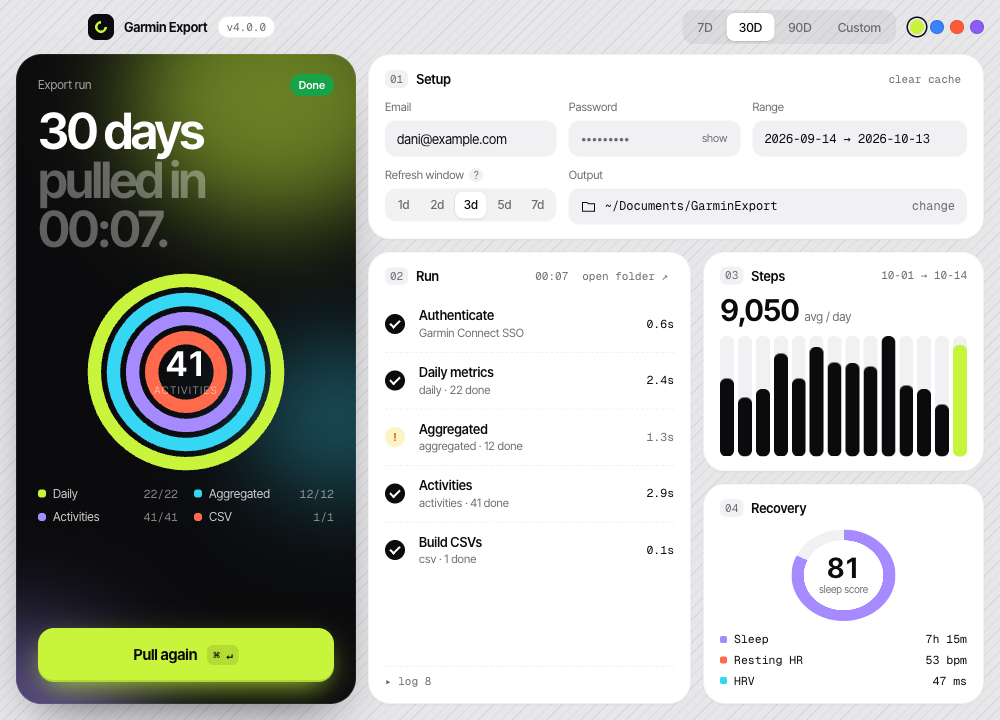
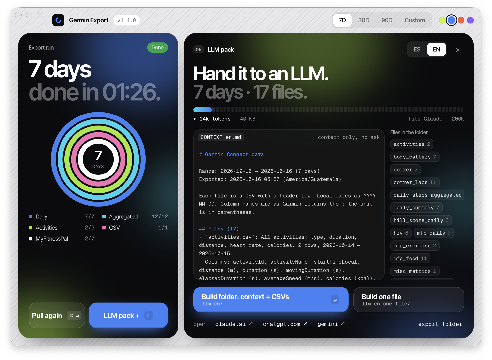
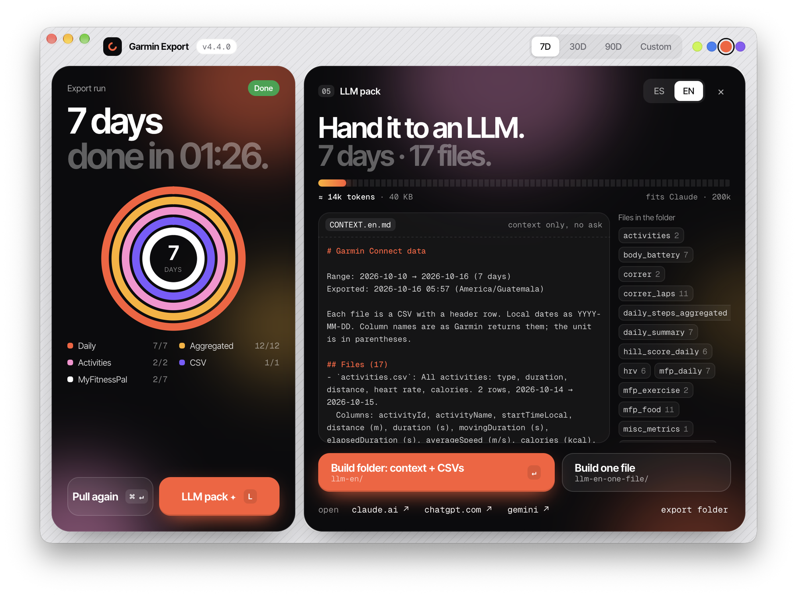
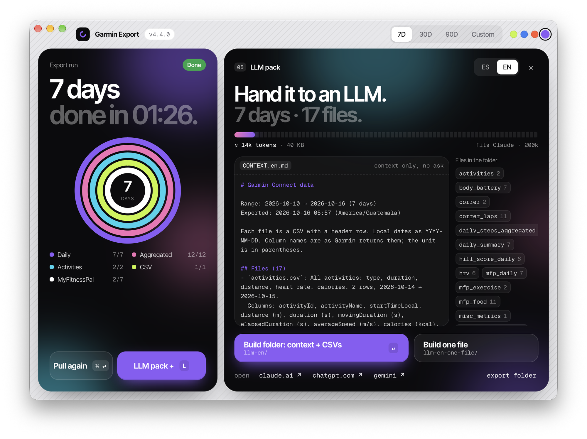

<div align="center">



<h1>Garmin Export</h1>

**A Mac app that downloads your Garmin Connect health data as CSV files.<br>It also packs the files so you can give them to Claude, ChatGPT, or Gemini.**

[](https://github.com/danihrndzld/garmin-health-exporter/releases/latest)
[](#install)
[](#build-it-yourself)

**[Download the latest version](https://github.com/danihrndzld/garmin-health-exporter/releases/latest)**

[What it exports](#what-it-exports) | [Install](#install) | [First export](#first-export) | [Give the data to an LLM](#give-the-data-to-an-llm) | [MyFitnessPal](#add-your-myfitnesspal-food-diary) | [Questions](#questions) | [Build it yourself](#build-it-yourself)

<br>



</div>

<br>

Garmin Export signs in to Garmin Connect with your account, downloads each day in the range you pick, and writes one CSV file per kind of data. The files are plain text with a header row, so you can open them in Numbers, Excel, or pandas, or upload them to a chat with an LLM.

Garmin Export is for personal use with your own account. It isn't affiliated with Garmin. It reads your data through the unofficial API that Garmin's own phone app uses, so it can stop working when Garmin changes that API.

---

## What it exports

Each export creates a folder named `csv_YYYY-MM-DD` inside your output folder, which is `~/Documents/GarminExport` by default. The folder holds these files.

- Daily health data, with one row per day, in `daily_summary.csv`, `sleep.csv`, `hrv.csv`, `body_battery.csv`, `training.csv`, and `spo2_respiration.csv`. The daily summary covers steps, calories, heart rate, stress, intensity minutes, and hydration.
- Longer term data in `weight_body_comp.csv`, `blood_pressure.csv`, `misc_metrics.csv`, `running_tolerance.csv`, `daily_steps_aggregated.csv`, `weekly_intensity.csv`, and `hill_score_daily.csv`. The misc file holds fitness age, race predictions, lactate threshold, and FTP.
- Activities, with every activity in `activities.csv` and one file per type in `caminar.csv`, `correr.csv`, and `gym.csv`. Each type also has a laps file, e.g., `correr_laps.csv`.
- The LLM pack folders, after you click a button in the pack panel, as described in [Give the data to an LLM](#give-the-data-to-an-llm).

The app also saves the raw JSON that Garmin returned next to the folder, in case you need a field that the CSV files leave out. A file is missing from the folder when Garmin has no data of that kind for your account, e.g., `blood_pressure.csv` when you never logged a reading.

## Install

Garmin Export needs macOS 11 or later, and the same download runs on Apple silicon and Intel Macs. The app isn't signed with an Apple Developer ID, so macOS asks you to confirm it the first time you open it.

1. Download `Garmin Export_X.Y.Z_universal.dmg` from the [latest release](https://github.com/danihrndzld/garmin-health-exporter/releases/latest).
2. Open the DMG, and drag Garmin Export to your Applications folder.
3. Open Garmin Export. When macOS says it can't verify the app, click Done.
4. Open System Settings, go to Privacy & Security, and click Open Anyway next to the Garmin Export message. Then confirm with your password.

<details>
<summary>Prefer the Terminal?</summary>

This command removes the download flag, and Garmin Export then opens normally.

```sh
xattr -dr com.apple.quarantine "/Applications/Garmin Export.app"
```

</details>

You only do this once for each version. To check for a new version, click the version number in the top left corner of the window. When a newer release exists, the label changes to the new version number, and a second click opens the release page.

## First export

1. In the Setup card, click connect on the Garmin row, type your Garmin Connect email and password, and click sign in. You only do this once. The app remembers your email.
2. Pick a range at the top of the window. You can choose the last 7, 30, or 90 days, or choose Custom and set a start and end date.
3. Click the Pull button, or press Command and Return. The Run card shows each step, and you can press Escape to cancel.

The app sends your password to Garmin once, when you connect, and it never saves the password. Garmin answers with a login token, and the app saves that token, not the password, in a file in its Application Support folder that only your user can read. Every later export uses the token, so you don't type the password again. The app renews the token before it expires, so a long export doesn't stop halfway. Unlike MyFitnessPal, the app does see your Garmin password, once, because Garmin's sign in is an API and not a web page that the app could show you.

When Garmin ends the login, the Garmin row says Session expired and its button changes to reconnect. Click reconnect and sign in again. The disconnect button deletes the saved token.

Each source in the Setup card has an Include switch that turns it on or off for the next exports. When you switch Garmin off, MyFitnessPal runs alone, and the folder holds only the MyFitnessPal files.

Downloaded days are also kept in a local cache, so a second export of the same range only asks Garmin for the newest days.

<div align="center">

</div>

<div align="center">
  
</div>

## Give the data to an LLM

Press L, or click LLM pack, to open the pack panel. The panel shows the description of your data in the language you pick, Spanish or English, and an estimate of the token count against a 200,000 token context window. The export itself doesn't write any LLM files. The app writes them only when you click one of the two buttons, and it writes only the language you picked.

1. Build folder writes `llm-en`, which holds `CONTEXT.en.md` and a copy of every CSV file, and it opens the folder. Drag everything in the folder into the chat, and then type your question.
2. Build one file writes `llm-en-one-file`, which holds one Markdown file with the description and every CSV file inside it, and it selects the file in Finder. Drag the file into the chat.

Each folder holds the data once, so you can drag the whole folder without sending the same rows twice. A second click replaces the folder. `CONTEXT.en.md` lists the date range, each file with its row count and dates, each column with its unit, and any data that Garmin didn't return, and it doesn't ask the LLM to do anything. The panel also has links that open claude.ai, chatgpt.com, and gemini.google.com.

The raw JSON is never part of the pack, because a 60 day export is about 38 MB, and Claude accepts files up to 30 MB. The CSV files for a 90 day export are about 350 KB, which is about 120,000 tokens.

## Add your MyFitnessPal food diary

After each Garmin export, the app can also download your food diary from MyFitnessPal and write it next to the Garmin files, so that an LLM can relate what you ate to your sleep, HRV, training, and weight. In the Setup card, click connect on the MyFitnessPal row, and sign in on MyFitnessPal's own page in a window of the app. The app never sees your MyFitnessPal password, and it only keeps the session that MyFitnessPal gives the window, in a file that only your user can read. Signing in with Google or Apple may not work inside the app window, so use your MyFitnessPal email and password there. The Include switch turns the download on or off for each export, it is available only after MyFitnessPal is connected, and the MyFitnessPal step appears in the Run card only then too. The disconnect button deletes the saved session.

The export adds three files to the `csv_*` folder, and every file uses the date as `YYYY-MM-DD`, the same as the Garmin files, so an LLM can join them by date.

- `mfp_food.csv` has one row for each food you logged, with the meal, the time, the serving, and the nutrients.
- `mfp_daily.csv` has one row for every day in the range, with the totals, your goals, and the exercise calories that you logged in MyFitnessPal.
- `mfp_exercise.csv` has one row for each exercise you logged in MyFitnessPal, and it can repeat exercise that Garmin already recorded.

A day without any food logged has `logged=no` and empty totals, which means that you didn't log, and it doesn't mean that you didn't eat. The LLM pack describes the three files and counts the days with a food log.

MyFitnessPal has no public API. The app uses the same private API as MyFitnessPal's website, and MyFitnessPal's terms don't allow automated access, so you use this at your own risk and only with your own account. The app only reads your diary, it makes one request per second, and it stops at the first rate limit answer. It can stop working when MyFitnessPal changes its site or its bot detection. When that happens, the MyFitnessPal row in the Run card shows "Skipped" with the reason, the log has a line that starts with "MyFitnessPal skipped", and the Garmin export is not affected. When your session expires, the row says Session expired and its button changes to reconnect.

## Questions

<details>
<summary>What is the refresh window?</summary>

The refresh window is the number of recent days that the app downloads again on every export, even when those days are already in the cache. Garmin keeps changing the newest days after you sync, e.g., last night's sleep can arrive late, and today's steps keep going up. With the default of 3 days, the app downloads today, yesterday, and the day before again, and it reads older days from the cache. The setting applies to daily data only, because activities don't change after you save them.

</details>

<details>
<summary>What do the [no data] and [skip] lines mean?</summary>

A line that starts with `[no data]` means that Garmin answered with HTTP 204, which is an empty answer, e.g., `[no data] endurance_score (HTTP 204)`. In tests on a Fenix 8, every 204 came from a day that the watch hadn't synced yet. The app downloads that day again on the next export, and it keeps doing so until the day is a week old, because Garmin can fill in a day late. A 204 on every day usually means that your watch doesn't record that metric. A `[skip]` line means a real error, e.g., HTTP 403, and the export goes on without that data. The skipped data is listed under missing data in `CONTEXT.en.md` when you build the LLM pack.

</details>

<details>
<summary>What happens when an export fails?</summary>

When an export fails, the Run card shows a red Report it bar with two buttons. GitHub issue opens a new issue on this repository with the error and the last lines of the log filled in, and email opens a message to the developer with the same text. Before the text leaves your Mac, the app replaces tokens and passwords with `REDACTED`, email addresses with `[email]`, and your home folder path with `~`.

</details>

<details>
<summary>I used Garmin Data Exporter 3.x. What changes?</summary>

Version 4 is a new app named Garmin Export built with Tauri instead of Electron. macOS treats it as a new app, so type your email again and sign in once. The CSV file names are the same as in 3.3. You can delete `Garmin Data Exporter.app` after you install version 4. The update button in 3.x stays on Checking... when a newer version exists, because of a bug in how 3.x compares version numbers, so download version 4 from the releases page by hand.

</details>

<details>
<summary>Why can't I sign in?</summary>

Since version 4.2, the app signs in the same way as Garmin's own phone app, through a sign in service that Garmin introduced in 2026. When Garmin blocks that service, e.g., from some VPNs or office networks, the app tries the older sign in once. The message under the Garmin row says which case you hit.

- Wrong email or password: check them on connect.garmin.com.
- Two-step verification: Garmin Export can't sign in to accounts with two-step verification yet.
- Rate limited (HTTP 429): Garmin limits how often one account can sign in. The app waits 15 minutes before it tries again, and it never retries on its own. Saved tokens keep working during that time, so this only affects a first sign in.
- Blocked (HTTP 403): try again later or from another network.

</details>

<details>
<summary>What does Clear cache do?</summary>

Clear cache deletes the local copy of downloaded days, so the next export downloads the whole range from Garmin again. Use it when you think that older days in your CSV files don't match Garmin Connect.

</details>

---

## Build it yourself

<details>
<summary>Requirements, build, and tests</summary>

You need Bun, Rust, Go 1.24 or later, and the Xcode command line tools. Version 4.5.0 ships one Go program, `garmin-export-core`, inside the app, so the DMG is about 15 MB. Install the packages and run the app from `tauri-app`.

```sh
git clone https://github.com/danihrndzld/garmin-health-exporter.git
cd garmin-health-exporter/tauri-app
bun install
bun run dev
```

`bun run build` makes an app and a DMG for your own Mac. `bun run release` makes a universal app and DMG, and it needs the `aarch64-apple-darwin` and `x86_64-apple-darwin` Rust targets, which you can add with `rustup target add`.

To run all the tests, use the command below. Most tests run the real sign in, client, cache and CSV code against a local server that imitates Garmin, so they never contact Garmin. The Go tests in `tauri-app/core` also run against a local server that imitates MyFitnessPal. The CSV output is compared byte by byte with the files in `tauri-app/core/internal/garmin/testdata/golden`. The window tests run in Chromium and WebKit with fake data, through Playwright.

```sh
cd tauri-app
bun run test
```

When a change to the Garmin CSV files is intended, rebuild the golden files with `UPDATE_GOLDEN=1 go test ./internal/garmin -run AC301` in `tauri-app/core` and check the diff. The test fixture comes from a real export through `bun scripts/make-fixture.js <garmin_health_*.json> <out.json>` in `tauri-app`, which removes ids, names and GPS, moves the dates by a random amount and changes every number by a random amount up to 30 percent.

</details>

<details>
<summary>Project layout</summary>

- `tauri-app/ui` holds the window, written in plain HTML, CSS, and JavaScript with no build step. `ui/dev-mock.js` lets you open `index.html` in a browser with fake data.
- `tauri-app/core` holds `garmin-export-core`, a Go program that connects Garmin, keeps the login token, downloads the Garmin data, writes the CSV files, builds the summary, the LLM pack and the bug report links, and downloads the MyFitnessPal diary. The window starts it for each command and sends one JSON request on its standard input, so your password never appears in the process list. It checks the range, the refresh window, and the folders before it does anything. The Garmin sign in and API client is the library [`github.com/danihrndzld/gconnect`](https://github.com/danihrndzld/gconnect), which never touches the disk.
- The 3.x Electron app and the earlier JavaScript code are at the git tag `archive/electron-app`.
- The original Python scripts (`garmin_health_export.py`, `json_to_csv.py`, `download_activity_details.py`) were removed in 4.5.0; they are in the git history.

</details>
